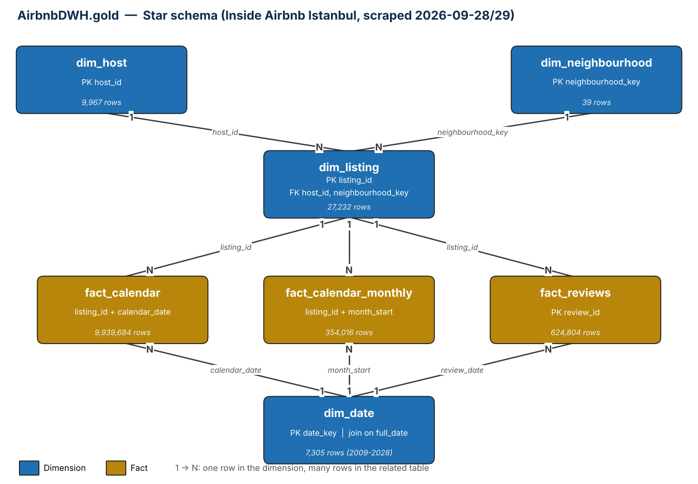

# airbnb-sql-powerbi

## Bronze layer load results

All four raw CSV files are loaded as-is with `BULK INSERT` by the `bronze.load_bronze` procedure (`sql/01_bronze/load_bronze.sql`). Row counts were checked against the source files; durations come from `etl.load_log`.

| Table | Rows loaded | Duration (sec) |
|---|---|---|
| bronze.airbnb_neighbourhoods | 39 | 0 |
| bronze.airbnb_listings | 27,232 | 2 |
| bronze.airbnb_calendar | 9,939,684 | 9 |
| bronze.airbnb_reviews | 624,804 | 2 |

Notes:
- The listings file has 90 columns and the calendar file has 5 columns (no price columns in this snapshot).
- 6 review comments already contain the Unicode replacement character in the source file; bronze keeps them unchanged.
## Silver layer

Typed, cleaned tables built from bronze (`sql/02_silver/`). Cleaning rules, decisions and data quality checks are documented in [docs/data_quality.md](docs/data_quality.md).

| Table | Rows | Content |
|---|---|---|
| silver.listings | 27,232 | 42 columns, one row per listing |
| silver.listing_amenities | 796,290 | listing x amenity |
| silver.listing_features | 27,188 | 7 amenity flags (44 listings have no amenities) |
| silver.calendar | 9,939,684 | listing x day, no price in source |
| silver.reviews | 624,804 | reviewer names not stored |
| silver.neighbourhoods | 39 | districts |

Notes:
- Prices are in Turkish lira (TRY); Inside Airbnb shows a `$` sign but the value is in local currency.
- `is_price_outlier` flags prices <= 0 or above the 99th percentile (38,317.80 TRY): 246 listings.
- `is_active` = available and at least one review in the last 12 months: 12,257 listings (45%).
- `license_status` replaces a yes/no license flag: Has number / Missing / Exempt / Non-real estate.
- Empty source columns are excluded: `host_since`, `host_response_time`, `host_response_rate`, `host_acceptance_rate`, `instant_bookable`.
- The database collation (Turkish_CI_AS) changes `LOWER('I')` to a dotless `ı` and ignores emojis in comparisons; text rules use explicit collations.

## Gold layer: star schema

Views and one date table in `sql/03_gold/`, consumed by Power BI. Column definitions: [docs/data_dictionary.md](docs/data_dictionary.md). Checks: `sql/03_gold/validate_gold.sql`.

Design decisions:
- Listing attributes and snapshot metrics (price, scores, availability) stay in `dim_listing`; a separate fact table would be 1:1 with it.
- `listing_id` and `host_id` are Inside Airbnb's stable ids and are used as natural keys; only `dim_neighbourhood` gets a surrogate key (ROW_NUMBER).
- The daily calendar is large (9.9M rows), so a monthly summary fact is also provided.
- `price_quartile` is computed only for non-outlier listings with a price; otherwise 2,679 listings without a price fall into the cheapest quartile.
- `min_stay_band` uses four bands (1-3 / 4-29 / 30-99 / 100+ nights) because 36.4% of listings require 100+ nights.
- `fact_calendar` keeps all listings for availability analysis; `price` and `est_revenue` are NULL for outliers and listings without a price.

Findings so far:
- **Professional hosts dominate supply:** hosts with 5+ listings are 13.3% of hosts but hold 55.2% of listings.
- **Unavailable is not booked:** listings without a price are 9.8% of listings but hold 26.5% of unavailable days, and 87.9% of them had no review in the last 12 months.
- **The forward calendar shows booking horizon, not seasonality:** for listings with open calendars, unavailability falls from 45% (next days) to under 1% (11 months ahead). In the full data, fully unavailable listings jump at 3, 6 and 9 months after the scrape, which points to host calendar windows.
- **Seasonality from reviews (2023-2025):** lowest share in February (5.7%), highest in October (10.4%).
- **Missing licences cluster in long-stay listings:** among listings with a 100+ night minimum stay, 95.2% have no licence number, versus 0.5% for shorter stays (correlation, not causation).
