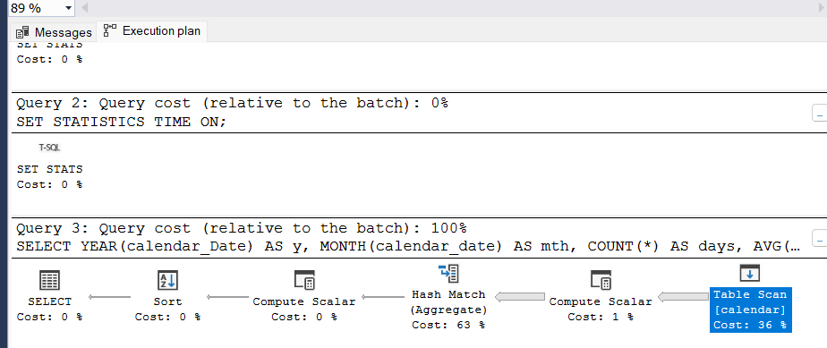
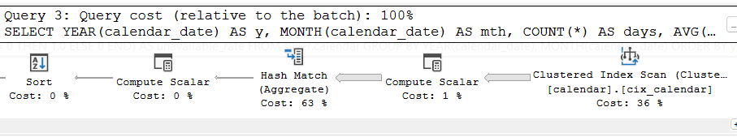
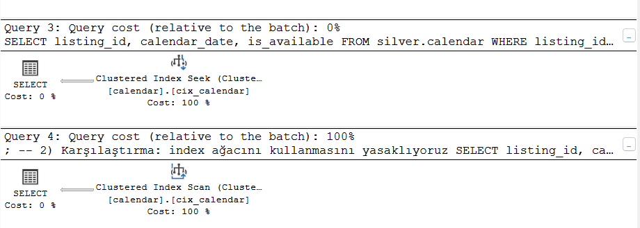
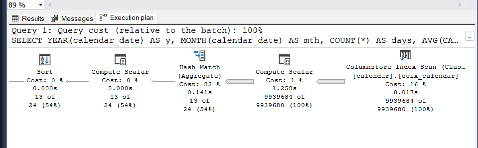

# Performance: silver.calendar index experiment

Script: [`sql/05_performance/calendar_index_experiment.sql`](../sql/05_performance/calendar_index_experiment.sql)

## Goal

`silver.calendar` is the largest table in the warehouse (9,939,684 rows, 27,232 listings, one row per listing per day).
The experiment measures how its storage structure affects two query patterns:

1. **Aggregation:** monthly day count and unavailable-day rate. Reads every row but only 2 columns.
2. **Point lookup:** the calendar of a single listing (365 rows).

Three stages were compared:

| Stage | Structure |
|---|---|
| A | Heap (no index) |
| B | Clustered rowstore index on `(listing_id, calendar_date)` |
| C | Clustered columnstore index |

## Method

- `SET STATISTICS IO ON` and `SET STATISTICS TIME ON`, plus the Actual Execution Plan in SSMS.
- Each query was run twice; the second (warm cache) run is reported.
- **Logical reads** are the main metric: they do not depend on cache state or machine load.
- Columnstore reads are reported by SQL Server as `lob logical reads`.
- `silver.calendar` has no price column, so the guide's `AVG(price)` was replaced by `COUNT(*)`.
- Environment: SQL Server 2022 Express on a local Windows PC, data snapshot 2026-09-28.

## Results

### Aggregation query

| Stage | Reads (pages) | CPU (ms) | Elapsed (ms) | Plan |
|---|---:|---:|---:|---|
| A: heap | 35,627 | 4,844 | 4,937 | Table Scan, Hash Match (row mode) |
| B: clustered rowstore | 35,718 | 4,875 | 4,867 | Clustered Index Scan, Hash Match (row mode) |
| C: clustered columnstore | 973 (lob) | 1,422 | 1,451 | Columnstore Index Scan, Hash Match (batch mode) |

### Point lookup (listing 41393479, 365 rows)

| Case | Reads (pages) | CPU (ms) | Elapsed (ms) | Plan |
|---|---:|---:|---:|---|
| Rowstore, index seek | 5 | 0 | 0 | Clustered Index Seek |
| Rowstore, forced full scan (`WITH (INDEX(0))`) | 35,718 | 453 | 443 | Clustered Index Scan |
| Columnstore | 298 (lob) | 0 | 53 | Columnstore Index Scan (8 of 10 segments skipped) |

## Execution plans

**A: heap**

**B: clustered rowstore index**

**B: point lookup, seek vs forced scan**

**C: clustered columnstore index**

## Findings

1. **Disk was not the bottleneck.** The cold run of stage A took 4,984 ms and the warm run 4,937 ms. The cost was CPU: the row-mode Hash Match was 63% of the plan.
2. **Reading the table is cheap, computing per row is not.** A full scan alone takes about 450 ms; the rest of the 4.9 s aggregation is per-row work.
3. **A clustered rowstore index does not help a full-table aggregation.** Stage B still read every page (plus 91 pages for the B-tree upper levels) and took the same time as the heap.
4. **A clustered rowstore index is ideal for point lookups.** Finding one listing took 5 page reads with a seek, against 35,718 with a full scan (about 7,000x fewer).
5. **Columnstore wins the aggregation.** It reads only the columns used, in compressed form: about 37x fewer reads and 3.4x faster. All operators ran in batch mode; the remaining time is mostly evaluating `YEAR()`, `MONTH()` and `CASE` per row (Compute Scalar, 1.26 s).
6. **Columnstore has no seek, but it can skip segments.** The point lookup skipped 8 of 10 row groups by their min/max metadata. This is likely because the columnstore was built from data already sorted by `listing_id` in stage B, and it is not guaranteed after a reload.

## Final choice

**Clustered columnstore index (`ccix_calendar`).**

Most queries on this table are aggregations: the gold fact views (`fact_calendar`, `fact_calendar_monthly`), the analysis queries (Q2, Q12) and the Power BI model. Columnstore reduced reads about 37x and time about 3.4x for this pattern.
The single-listing lookup is slower than a rowstore seek (298 vs 5 pages), but at 53 ms it is still fast enough, and no query in the project depends on it.
An extra nonclustered rowstore index on `listing_id` was not added, because no measured query needs it.

## Limitations

- Measurements come from a single local machine (SQL Server Express) and a single snapshot; absolute times will differ elsewhere, the read counts and the relative differences are the meaningful part.
- Index build times were not recorded.
- Load performance with the columnstore index (insert into an empty indexed table vs. build the index after loading) has not been measured yet.
